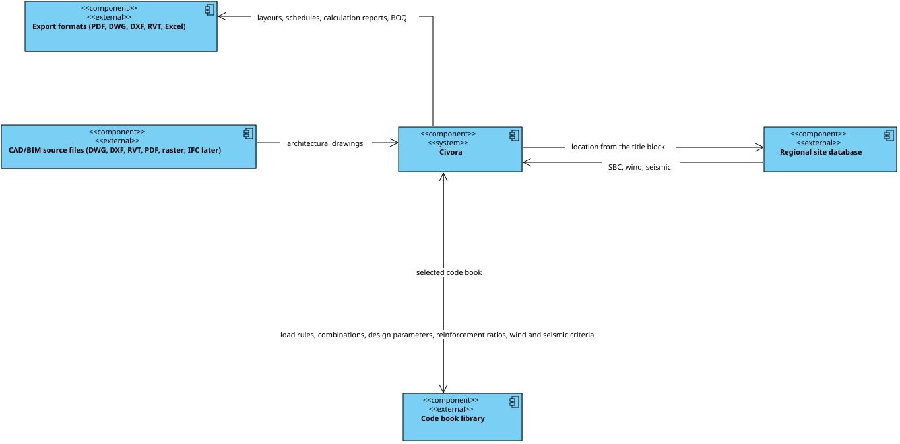
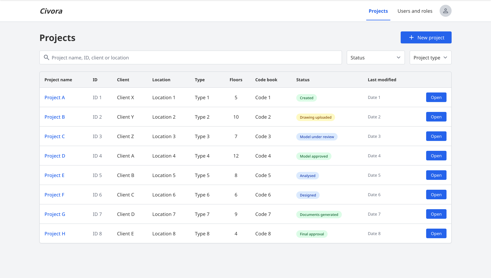

# Civora

**AI-assisted structural engineering platform that turns architectural CAD/Revit drawings into an analysed, designed and documented reinforced-concrete structural system.**

> **Status:** design and documentation phase. This repository holds the requirements, architecture, UML/ER models, UI wireframes and the Visual Paradigm project. There is no application source code yet.

---

## Overview

Civora takes an architectural drawing as input and carries it through the whole structural workflow:

```
Architectural input → Drawing ingestion → AI understanding → Structural model
        → Load generation → FEA analysis → Design → Review → Documents
```

### Core design principle

> **AI proposes → engineering engine calculates → engineer reviews → engineer approves → system generates.**

Civora is an interactive workspace, not a black box. At every stage the engineer can inspect detections, check confidence scores, edit parameters, lock approved elements, rerun calculations and monitor discrepancies. It assists a structural engineer; it does not replace professional responsibility for the design.

### Main modules

| Core and data | Engineering and output |
|---|---|
| Authentication and user management | Load and analysis (FEA) engine |
| Project and drawing management | Design engine and member grouping |
| AI drawing recognition engine | Reinforcement and detailing database |
| Project / site information | Drawing and document generators |
| Structural canonical model (single source of truth) | Review, approval and BOQ engines |

### Key ideas

- **Drawing intelligence:** reads DWG, DXF, RVT, PDF and raster images (IFC and other BIM formats planned), extracts title-block data and feeds the site-information engine.
- **Site information engine:** looks up soil, wind and seismic parameters, clearly separating AI-suggested defaults from engineer-confirmed values.
- **Canonical structural model:** one shared internal model that analysis, design and drawing generators all read, so data stays consistent.
- **Member grouping:** classifies similar members after design (e.g. beams B1/B2, columns C1/C2) to simplify construction.
- **Traceability:** changes propagate through dependent results, and every edit, approval and release is logged.

---

## Repository structure

```
Civora/
├── README.md
├── docs/                      Specification and project documentation
│   ├── Civora-UX-UI-UML-Architecture-Specification.pdf
│   ├── Civora-Project-Documentation.docx     (current, v2)
│   └── archive/Civora-Project-Documentation-v1.docx
├── diagrams/
│   ├── uml/                   Use case, class, component, deployment, state, activity, sequence
│   ├── database/erd.svg       Entity-relationship diagram
│   └── drafts/                Early drafts
├── ui-mockups/
│   ├── wireframes/            13 numbered screens (01-sign-in … 13-users-and-roles)
│   ├── prototype-screens/     Balsamiq prototype captures
│   └── mockup-board-sign-in-and-projects.png
└── models/
    └── Civora.vpp             Visual Paradigm project (latest)
```

## Documentation

| File | What it is |
|---|---|
| [`docs/Civora-UX-UI-UML-Architecture-Specification.pdf`](docs/Civora-UX-UI-UML-Architecture-Specification.pdf) | UX/UI, UML and system design specification |
| [`docs/Civora-Project-Documentation.docx`](docs/Civora-Project-Documentation.docx) | Document set: requirements (SRS), architecture, data dictionary, engineering methodology, AI models, interfaces, test plan and user manual |

## Diagrams

All diagrams are SVG, so they render directly on GitHub.

| Diagram | File |
|---|---|
| Use case | [`use-case-diagram.svg`](diagrams/uml/use-case-diagram.svg) |
| System context | [`system-context-diagram.svg`](diagrams/uml/system-context-diagram.svg) |
| Component | [`component-diagram.svg`](diagrams/uml/component-diagram.svg) |
| Deployment | [`deployment-diagram.svg`](diagrams/uml/deployment-diagram.svg) |
| Class | [`class-diagram.svg`](diagrams/uml/class-diagram.svg) |
| Entity-relationship (database) | [`erd.svg`](diagrams/database/erd.svg) |
| Activity: structural design automation | [`activity-structural-design-automation.svg`](diagrams/uml/activity-structural-design-automation.svg) |
| Sequence: upload drawing to reviewed model | [`sequence-upload-drawing-to-reviewed-model.svg`](diagrams/uml/sequence-upload-drawing-to-reviewed-model.svg) |
| Sequence: loads, analysis, design and documents | [`sequence-loads-analysis-design-documents.svg`](diagrams/uml/sequence-loads-analysis-design-documents.svg) |
| Sequence: change propagation (column C17 section change) | [`sequence-change-propagation-column-c17.svg`](diagrams/uml/sequence-change-propagation-column-c17.svg) |
| State machine: detected-element review | [`state-machine-1-detected-element-review.svg`](diagrams/uml/state-machine-1-detected-element-review.svg) |
| State machine: project lifecycle | [`state-machine-2-project-lifecycle.svg`](diagrams/uml/state-machine-2-project-lifecycle.svg) |
| State machine: result validity | [`state-machine-3-result-validity.svg`](diagrams/uml/state-machine-3-result-validity.svg) |



## UI wireframes

| # | Screen | | # | Screen |
|---|---|---|---|---|
| 01 | [Sign in](ui-mockups/wireframes/01-sign-in.png) | | 08 | [Design and member groups](ui-mockups/wireframes/08-design-and-member-groups.png) |
| 02 | [Project dashboard](ui-mockups/wireframes/02-project-dashboard.png) | | 09 | [Review queue](ui-mockups/wireframes/09-review-queue.png) |
| 03 | [New project and code books](ui-mockups/wireframes/03-new-project-and-code-books.png) | | 10 | [Change propagation](ui-mockups/wireframes/10-change-propagation.png) |
| 04 | [Drawing upload](ui-mockups/wireframes/04-drawing-upload.png) | | 11 | [Change impact](ui-mockups/wireframes/11-change-impact.png) |
| 05 | [Title block and site data](ui-mockups/wireframes/05-title-block-and-site-data.png) | | 12 | [Documents and export](ui-mockups/wireframes/12-documents-and-export.png) |
| 06 | [Workspace](ui-mockups/wireframes/06-workspace.png) | | 13 | [Users and roles](ui-mockups/wireframes/13-users-and-roles.png) |
| 07 | [Loads and analysis](ui-mockups/wireframes/07-loads-and-analysis.png) | | | |



## Working with the Visual Paradigm model

`models/Civora.vpp` is the source model for the UML and ER diagrams. Open it with [Visual Paradigm](https://www.visual-paradigm.com/). Visual Paradigm's automatic backup files (`*.vpp.bak*`, `*.vbak`) and lock files are excluded by `.gitignore`. Because `.vpp` is a binary format, avoid editing it on two machines at once; Git cannot merge it.

## Proposed technology (not yet decided)

The specification does not fix a stack. The documentation proposes a web application with: a browser client with 2D/3D viewport, a web/API server, an application server for the engineering engines, a job queue with workers for ingestion/analysis/document generation, an AI inference server (possibly GPU), a relational database for the canonical model, and object or file storage for drawings and generated documents.

## Roadmap

- [x] Requirements and architecture specification
- [x] UML and ER models
- [x] UI wireframes
- [ ] Choose the technology stack
- [ ] Prototype drawing ingestion
- [ ] Prototype canonical model, load generation and analysis
- [ ] First working review workspace

## License

No license has been chosen yet. Until one is added, all rights are reserved.
